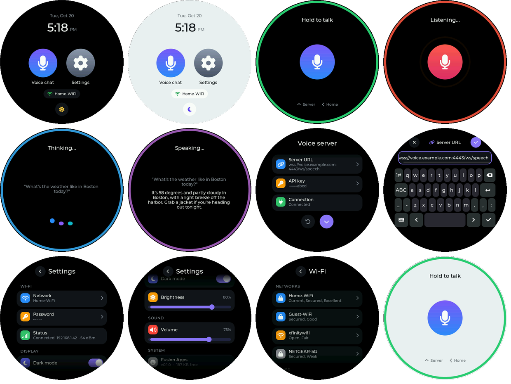
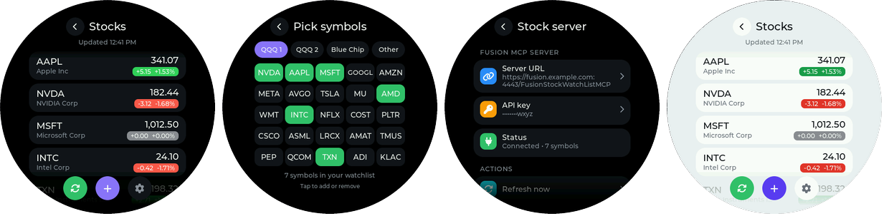

# esp32-s3-1-75c-fusion-apps — App launcher for the ESP32-S3-Touch-AMOLED-1.75C

A small "watch OS" for the Waveshare **ESP32-S3-Touch-AMOLED-1.75C**: a home screen with a clock and
app icons, a **Voice chat** app (client for the Amplify Fusion WebSocket voice server: say "Jarvis" or
hold to talk),
a **Stocks** app (watchlist client for the FusionStockWatchListMCP server, an Amplify Fusion MCP
server) and a **Settings** app. Day and night themes, Font Awesome icons, slide transitions.



*Screenshots are rendered by `tools/ui_preview` from the real UI code (see below), not photos of
the device.*



> **Stocks is new and untested on the board.** Its screens are compiled and clicked through on a
> PC against LVGL 9.5 (`tools/ui_preview`), its reply parsing and MCP message handling pass host
> tests (`tools/stocks_test`), and the ESP-IDF code is syntax-checked against the IDF 5.5.2
> headers, but it hasn't been built with `idf.py` or talked to the real server yet.
> Expect a small fix or two on the first build.

> **The wake word is new and untested on the board.** The engine code is syntax-checked against
> the ESP-IDF 5.5.2 and ESP-SR 2.6 headers and the screens are checked in `tools/ui_preview`, but it
> hasn't been built with `idf.py` or heard anyone say "Jarvis" yet. Watch the `voice` lines in the
> log on the first run, especially the internal RAM numbers when Voice chat opens.

---

## What's on the device

| Screen | What it does |
| --- | --- |
| **Home** | Battery level and charging state, date and time (from NTP), app icons, Wi-Fi status, day/night button |
| **Voice chat** | Say "Jarvis" and your request (wake word), or hold to talk and release to send. Shows what the server heard and its reply, plays the reply audio |
| **Voice server** (swipe up/down in Voice chat) | See and change the server URL and API key, connect/disconnect switch with status, reset URL to `secrets.h` |
| **Stocks** | Your watchlist: symbol, company, price, change and % change, colored green or red. Refreshes every minute while open; the ↻ / ❚❚ button pauses and resumes auto refresh |
| **Quote** (tap a row in Stocks) | A detailed quote from `GetStockQuote`: price, change, open, previous close and the day's range (low–high with today's price marked). Refresh and remove buttons |
| **Pick symbols** (+ or swipe left in Stocks) | Tabs of preset symbols (**QQQ 1**, **QQQ 2**, **Blue Chip**) and **Other** (watchlist symbols not on a tab, e.g. added from Claude). Tap to add (green) or remove (gray) |
| **Stock server** (gear in Stocks) | See and change the MCP server URL and API key, connection status, refresh now, reset URL to `secrets.h` |
| **Settings** | Wi-Fi network (scan list or typed name) and password, dark mode, brightness, volume, voice-chat conversation (show / start new) and wake word on/off, battery (%, state, voltage), version and free memory, restart, reset |

### Gestures

| Where | Gesture | Result |
| --- | --- | --- |
| Voice chat | Say "Jarvis", then your request | Records until you stop talking, then sends (wake word on) |
| Voice chat | Quick tap | Same as saying "Jarvis" (wake word on) |
| Voice chat | Touch and hold | Record while held (up to 10 s); release to send |
| Voice chat (disconnected) | Tap | Connect again |
| Voice chat | Swipe up / down | Voice server settings |
| Voice chat, Voice server | Swipe left / right | Back to Home |
| Voice server | Swipe up / down, or the ⌄ button | Back to Voice chat |
| Stocks | Swipe left, or the + button | Pick symbols |
| Stocks | Swipe right, or the ‹ button | Back to Home |
| Stocks | Tap a row | Quote screen for that symbol |
| Stocks | Long-press a row | Remove that symbol (asks first) |
| Quote | Swipe right, or the ‹ button | Back to Stocks |
| Pick symbols | Tap a symbol | Add or remove it (orange while it's being saved) |
| Pick symbols, Stock server | Swipe right, or the ‹ button | Back to Stocks |
| Settings and its screens | Swipe right, or the ‹ button | Back |

Recording starts the moment your finger lands, so your first word isn't cut off. If the finger
then moves at least 60 px within 0.8 s, the touch was a swipe and the recording is thrown away.

### The wake word

With **Settings > Voice chat > Wake word** on (the default), the Voice chat screen listens for
"Jarvis" using Espressif's ESP-SR (WakeNet for the word, voice activity detection for the end of
your request). Everything runs on the board; nothing is sent until you've said the word.

| What you do | What happens |
| --- | --- |
| Open Voice chat | The status says **Say "Jarvis"**, with "or tap to talk" under the mic |
| Say "Jarvis" | A short two-note chime, the ring turns red: **Listening...** |
| Keep talking ("Jarvis, what's the weather"), or pause and then talk | Both work. The turn ends after 0.8 s of silence (`WAKE_END_SILENCE_MS`) or 10 s |
| Say nothing for 5 s (`WAKE_NO_SPEECH_MS`) | "Didn't catch that"; back to waiting for the word |
| Quick tap (under 0.35 s) | Listens the same way, without the word |
| Touch and hold | Hold to talk, as before |

- It only listens while the **Voice chat screen** itself is showing, with the connection on. On
  Home, other apps, the Voice server screen, or with the connection switched off, the microphone
  is off.
- It starts listening once the server connection is up (the green ring), not during the screen's
  slide-in and TLS handshake, which need internal RAM too.
- Detection is off while a reply is thinking or playing, so the speaker can't wake it.
- While the wake word is on, the 3-minute idle disconnect doesn't apply: the connection stays up
  as long as Voice chat is open, so it's ready when you say the word. Back to Home disconnects.
- The audio sent to the server is the same as with hold to talk (both mics mixed, 16 kHz mono WAV).
- "Talking" means ESP-SR's voice activity detection says speech, **or** the sound is 12 dB above
  the room's noise level (learned while it waits for the word). Less than 0.4 s of voice (the tail
  of "Jarvis", a click) doesn't count. With `WAKE_DEBUG 1` the log shows
  `voice: listen: vad=1 level=-38 dB (voice above -52) -> voice` four times a second while
  listening, which is how to tune `WAKE_LEVEL_*` in `voice_core.c` if it ends too early or late.
- It needs about 20-30 KB of internal RAM. If less than `WAKE_MIN_FREE_INTERNAL_KB` would be left
  for the display, it turns itself off for this visit ("Wake word off: low memory", Settings shows
  "Paused: low memory") and hold to talk keeps working. The log says how much it took.
- Another built-in word ("Computer", "Hi ESP", "Alexa"...): see "Settings you might change".

### The server connection

| When | What happens |
| --- | --- |
| Voice chat opens | Connects with the saved `conversationId`; the Connection switch starts **on** |
| While connected | A ping every 20 s keeps the link alive; if it drops, the client retries every 5 s. Wi-Fi power saving is off for faster uploads |
| Reconnecting (switch, tap, after idle or a drop), Home, reboot | Same `conversationId` |
| **New conversation** (Settings > Voice chat, or the conversation button on the Voice server screen) | Saves a new `conversationId` and reconnects with it |
| 3 min without a turn or a touch (`VOICE_IDLE_DISCONNECT_MS`), wake word off | Disconnects, on any screen; the mic turns gray: "Tap to connect" |
| Connection switch on the Voice server screen | Off = disconnect now, on = connect again |
| Tap the gray mic | Reconnects |
| Back to Home | Disconnects; Wi-Fi power saving goes back on |

Turning the connection off in the middle of a reply stops the playback.

If the link stalls while a recording is being sent (the write times out after 15 s), the WebSocket
library drops the connection and reconnects. The app shows "Connection lost - resending...", waits
up to 20 s (`RESEND_WAIT_MS` in `voice_core.c`) for the new connection and sends the same recording
once more. If that fails too, it shows "Send failed - try again".

Wi-Fi joins the **strongest** access point with your network name (it scans all channels first),
which matters on mesh networks and with extenders. The log shows which one:
`net: Wi-Fi connected, IP ..., AP xx:xx:..., channel N, -NN dBm`. The choice is made when Wi-Fi
connects; the board doesn't switch access points while it stays connected.

### Battery

The battery level comes from the board's AXP2101 power chip (I2C address 0x34, read every 2 s).

| Home shows | Meaning |
| --- | --- |
| battery icon + 87% (gray) | On battery |
| battery icon + 12% (red) | On battery, 15 % or less |
| green bolt + battery + 64% | Charging |
| green plug + battery + 100% | On USB, charging finished |
| plug + USB | USB power, no battery connected |
| (nothing) | The power chip didn't answer; the log says `power: AXP2101 not found` |

**Settings > System > Battery** adds the state in words and the battery voltage. The percentage is
the chip's own fuel gauge; it can take a few charge cycles to settle after a new battery goes in.

### Memory

**Settings > System** shows `Free: RAM 50 KB • PSRAM 7.1 MB`, refreshed every second:

- **RAM** is the ESP32-S3's internal memory (512 KB in total). It's the one that runs short:
  tasks, Wi-Fi, LVGL and the display's DMA transfers need it. About 50 KB free is normal with
  Wi-Fi up, and most of it is the 48 KB that `sdkconfig.defaults` keeps reserved for the display
  (`CONFIG_SPIRAM_MALLOC_RESERVE_INTERNAL`). Around 20 KB or less, or
  `Draw bitmap failed: ESP_ERR_NO_MEM` in the log, means something is using too much.
- **PSRAM** is the 8 MB external memory. Big buffers (audio, TLS, quotes) go there.

The boot log has the same numbers plus the largest free DMA block:
`app: Free memory: internal NN KB (largest DMA block NN KB), PSRAM NNNN KB`.

Adding the wake word (ESP-SR) cost about 12 KB of internal RAM at boot (free dropped from about
50 KB to 38 KB), and opening Voice chat with a TLS connection then left too little for the display
(`Draw bitmap failed`). To win it back, `sdkconfig.defaults` moves code out of internal RAM (on
the S3, code in IRAM and the heap share the same SRAM): Wi-Fi's IRAM speed-ups are off
(`CONFIG_ESP_WIFI_IRAM_OPT`, `CONFIG_ESP_WIFI_RX_IRAM_OPT`), FreeRTOS and ring buffer functions run
from flash, and the voice engine's task stacks are in PSRAM. These settings only apply after
`rm sdkconfig && idf.py set-target esp32s3`. The `vdiag: on connect ... heap int NN KB (dma blk NN KB)`
line shows what's left once Voice chat is connected.

The display needs one more thing: LVGL draws the screen in bands, and while a band is sent the SPI
driver borrows an internal DMA buffer the size of the band (the bands themselves are in PSRAM).
The BSP's bands were 50 lines (45 KB), so once free internal RAM was split up, every other band
failed and the screen showed stripes. `main/display_start.c` starts the display like
`bsp_display_start()` but with `APP_LVGL_BUF_LINES` (12) lines per band, about 10 KB each. The boot
log shows `display: Display started: 12-line draw bands (10 KB each)`.

### The Stocks app

Stocks is an MCP client: it calls the tools of your
[FusionStockWatchListMCP](https://github.com/lbrenman/Amplify-Fusion-Stock-Watch-List-MCP) server, the
same server the [StackChan watchlist](https://github.com/lbrenman/m5-stockchan-stock-watchlist-mcp-client)
uses, so both devices (and Claude) share one watchlist.

| When | What happens |
| --- | --- |
| Stocks opens | Connects (`initialize`), then loads the symbol list and the quotes |
| While open, auto refresh on | Symbols + quotes every 60 s (`STOCKS_REFRESH_MS`); after a failure, a retry every 15 s |
| Auto refresh off (❚❚) | No timed refreshes. The quotes stay on screen and the status line shows how old they are. Turning it back on refreshes right away. The choice is saved on the device |
| Tap symbols on Pick | Each tap is queued and sent in order, one request at a time; the button is orange until the server answers. Then the list and quotes reload once |
| Back to Home | Finishes any queued adds/removes, then closes the connection |

All requests run in the Stocks engine's own task (`stocks_core.c`), so the screen never freezes
while one is running, unlike the StackChan version. Requests close together (the first load, a
refresh) share one TLS connection; after 30 s idle the next request opens a new one.

Status line on the watchlist:

| Status | Meaning |
| --- | --- |
| Updated 4:41 PM | Last successful refresh (shows "Updated 12s ago" until the clock is set) |
| Updating... | A refresh is running |
| Paused • updated 4m ago (amber) | Auto refresh is off |
| *message* • 3m ago (red) | The last refresh failed; the quotes on screen are from 3 minutes ago |
| Set the server URL (gear button) | No URL yet, or still the `secrets.h.example` placeholder |

How Stocks uses the server's tools (names and the argument name are in `app_config.h`):

| Tool | Used for | Reply the app expects |
| --- | --- | --- |
| `GetStockWatchListSymbols` | The symbol list (also shows tickers the server can't quote as "no quote" rows) | `AAPL,INTC,TXN` |
| `GetStockWatchList` | Quotes | `{"Watchlist":[{"Symbol":"AAPL","Name":"Apple Inc","Price":341.07,"Change":5.15,"ChangePercent":1.5331}]}` |
| `AddSymbolToStockWatchList` | Add, `{"symbol":"AAPL"}` | `Symbol AAPL successfully added` / `Symbol already exists` |
| `RemoveSymbolFromStockWatchList` | Remove, `{"symbol":"AAPL"}` | `Successfully removed AAPL ...` / `Error deleting ...` |
| `GetStockQuote` | The Quote screen, `{"symbol":"AAPL"}` | `{"Quote":{"Symbol":"AAPL","Name":"Apple Inc","Price":341.07,"Change":5.15,"ChangePercent":1.53,"DayHigh":343.2,"DayLow":335.8,"OpenPrice":336.1,"PreviousClose":335.92}}` |

The Quote screen shows the watchlist's numbers at once and fills in the rest when `GetStockQuote`
answers (it jumps ahead of a pending watchlist refresh). While it's open and auto refresh is on, it
refreshes every `STOCKS_REFRESH_MS`. A quote of all zeros (what the quote service returns for a
ticker it doesn't know) shows as "No quote for XYZ".

`RemoveAllSymbolsFromStockWatchList` is never called. The server always answers
`isError: false`, so, as on the StackChan, the add/remove result comes from the message text, and
"Error deleting" is read as "it wasn't in the list". Other reply shapes (plain JSON arrays, other key
names, numbers as strings, JSON encoded twice) are accepted too; see `main/apps/stocks_parse.c`.

The MCP client (`main/mcp_client.c`) speaks Streamable HTTP: one HTTPS `POST` per JSON-RPC message
with `x-api-key`, `Mcp-Session-Id` (from `initialize`) and `MCP-Protocol-Version` headers. It reads
both plain-JSON and SSE (`data: {...}`) replies. A network error, a 5xx, or an expired session (404)
is retried once with a new connection and, if needed, a new session; a reply from the server (an
RPC error or a tool error) is not retried.

### Voice chat ring colors

| Ring | Status | Meaning |
| --- | --- | --- |
| Amber | Waiting for Wi-Fi... / Connecting... | Connecting to Wi-Fi or the server |
| **Green** | **Say "Jarvis"** / **Hold to talk** | Ready (wake word on / off) |
| Red | Listening... | Recording (the mic orb pulses); after the wake word it stops when you do |
| Blue | Thinking... | Waiting for the reply (three bouncing dots) |
| Purple | Speaking... | Playing the reply |
| Red | Not connected | No usable server URL; the note under the mic says what to fix |
| Gray | Disconnected | Switched off, or idle timeout; tap to connect |

---

## Settings: secrets.h is only the first-boot default

`main/secrets.h` holds your Wi-Fi and server values, as before. On first boot the device copies
them into its settings. Anything you change on the device (Wi-Fi in Settings, URL and API key in
Voice chat or Stocks, the Stocks auto-refresh switch) is saved in the device's flash (NVS) and
survives reboots and re-flashing.

The Stocks server comes from two lines you add to `main/secrets.h` (see `main/secrets.h.example`):

```c
#define STOCKS_MCP_URL      "https://your-fusion-host:4443/FusionStockWatchListMCP"
#define STOCKS_MCP_API_KEY  "your-mcp-api-key"
```

An older `secrets.h` without them still builds; Stocks then asks you to set the URL with the gear
button. Values already saved on the device win over `secrets.h` until **Settings > Reset settings**.

- **Settings > Reset settings** goes back to the `secrets.h` values.
- `idf.py erase-flash` also clears them.
- Secrets are never printed to the serial log and are shown masked on screen (`••••••••abcd`).
- Values typed on the device are stored unencrypted in flash, as the compiled-in `secrets.h`
  values already are.

## Folder layout

```
esp32-s3-1-75c-fusion-apps/
├── CMakeLists.txt, partitions.csv, sdkconfig.defaults   Waveshare 1.75C base (+ this project's settings;
│                                  partitions.csv has a 1 MB "model" partition for the wake word)
├── sdkconfig.fusion_apps          just this project's settings, for reference
├── components/bsp_extra/          Waveshare's audio helper (codec, I2S, speaker amp)
├── main/
│   ├── app_main.c                 boot: settings -> display -> battery -> UI -> audio -> stocks engine -> Wi-Fi
│   ├── app_config.h               compiled-in options: time zone, 12/24 h clock, animation time...
│   ├── settings_store.c/.h        settings in NVS, defaults from secrets.h
│   ├── net.c/.h                   Wi-Fi station, scanning, NTP clock
│   ├── mcp_client.c/.h            small MCP client: Streamable HTTP, sessions, SSE replies
│   ├── text_ascii.c/.h            turns ’ “ ” – é ... into ASCII the built-in fonts can draw
│   ├── power.c/.h                 battery level and charging from the AXP2101 power chip
│   ├── display_start.c/.h         starts display + touch + LVGL like the BSP, with smaller draw bands
│   ├── secrets.h.example          copy to secrets.h (gitignored)
│   ├── minimp3.h, minimp3_impl.c  MP3 decoder (CC0)
│   ├── ui/
│   │   ├── ui_theme.c/.h          day/night palettes and app colors
│   │   ├── ui_nav.c/.h            screen stack, app open/close, transitions
│   │   ├── ui_widgets.c/.h        list screens, rows, switches, sliders, editor + keyboard, toasts, dialogs
│   │   └── ui_icons*.c/.h         icon fonts (16/20/28/56 px), generated from Font Awesome
│   └── apps/
│       ├── apps.c/.h              the app list shown on Home
│       ├── app_home.c             Home screen
│       ├── app_settings.c         Settings app (+ Wi-Fi scan screen)
│       ├── app_voice.c            Voice chat screen + Voice server screen
│       ├── voice_core.c, voice.h  recording, wake word, WebSocket, playback (no LVGL in here)
│       ├── app_stocks.c           Stocks: Watchlist, Quote, Pick symbols and Stock server screens
│       ├── stocks_core.c, stocks.h   the Stocks engine task: tool calls, queue, refresh timer (no LVGL)
│       └── stocks_parse.c/.h      parses the watchlist server's replies (pure C, host-tested)
├── tools/
│   ├── make_icon_font.py          regenerates main/ui/ui_icons*.c
│   ├── ui_preview/                runs the UI on your Mac and saves screenshots
│   └── stocks_test/               host tests for the Stocks reply parsing and MCP reply handling
├── assets/                        Font Awesome Free TTF + license (input for make_icon_font.py)
└── docs/screenshots/
```

All LVGL work happens in the LVGL task. The voice and stocks engines, Wi-Fi and settings never touch LVGL
objects; the screens read their state from LVGL timers. That keeps tasks from drawing on screens
that have already been closed.

## Requirements

Same as voice_chat:

- Waveshare **ESP32-S3-Touch-AMOLED-1.75C** (not the plain 1.75)
- ESP-IDF **5.5 or newer**, exported in your terminal (`get_idf`)
- `openssl` (preinstalled on macOS), used once to fetch the server certificate
- A 2.4 GHz Wi-Fi network, a speaker on the board's speaker connector, and your voice server on `wss://`

## Setup

ESP-IDF doesn't support paths with spaces, so keep the project in `~/esp/projects`.

```bash
# 1. Unpack the project
mkdir -p ~/esp/projects && cd ~/esp/projects
unzip ~/Downloads/esp32-s3-1-75c-fusion-apps.zip
cd esp32-s3-1-75c-fusion-apps

# 2. Your settings. Reuse the voice_chat ones if you have them...
cp ~/esp/projects/ESP32-S3-1-75C-fusion-voice-chat/main/secrets.h main/secrets.h
#    ...or start from the template:
#    cp main/secrets.h.example main/secrets.h && open -e main/secrets.h

# 3. Build, flash, watch the log (exit the monitor with Ctrl-])
get_idf
idf.py set-target esp32s3
idf.py -p /dev/cu.usbmodem101 build flash monitor
```

The first build downloads the BSP, LVGL, the WebSocket client and ESP-SR (the wake word) and fetches `main/server_ca.pem`
from `WS_HOST:WS_PORT`, so it takes a few minutes.

Optional: put it in git and on GitHub (`secrets.h` and `server_ca.pem` are gitignored):

```bash
git init && git add . && git commit -m "First draft: home screen, voice chat, settings"
gh repo create lbrenman/esp32-s3-1-75c-fusion-apps --public --source . --push
```

## TLS certificate

As in voice_chat, the build saves the server's certificate chain to `main/server_ca.pem` and
compiles it in. The device uses it when the server URL's host is the `WS_HOST` from `secrets.h`.
If you point Voice chat at a **different host** on the device, it checks that server against
ESP-IDF's built-in CA bundle instead (the log says `using the built-in CA bundle`). That works for
servers with publicly trusted certificates that send their full chain; for anything else, put the
new host in `secrets.h` and refresh the certificate:

```bash
rm main/server_ca.pem && idf.py reconfigure && idf.py build flash
```

Stocks follows the same rule: if the host in its server URL is `WS_HOST` (your Fusion sandbox
usually serves both on port 4443), it uses `server_ca.pem`; any other host is checked against the
built-in CA bundle (the `mcp` log line says which). Unlike the StackChan version, the certificate
is always verified.

## Adding an app

1. Create `main/apps/app_<name>.c` with a build function that returns a screen, and a descriptor:

   ```c
   #include "apps.h"
   #include "ui_widgets.h"

   static lv_obj_t *build(void *arg)
   {
       lv_obj_t *scr;
       lv_obj_t *list = ui_list_screen(&scr, "Hello", true);   // header + back button + swipe-right back
       ui_row(list, ICON_INFO, UI_C_BLUE, "Hello", "From a new app", NULL, NULL);
       return scr;
   }

   const ui_app_t APP_HELLO = {
       .name = "Hello", .icon = ICON_ROBOT,
       .color1 = 0xFF9F0A, .color2 = 0xFF5A1F,     // tile gradient
       .build = build,                             // .on_enter / .on_leave are optional
   };
   ```

2. Declare it in `main/apps/apps.h` (`extern const ui_app_t APP_HELLO;`) and add `&APP_HELLO` to
   `g_apps` in `main/apps/apps.c`.
3. Add the file to `SRCS` in `main/CMakeLists.txt`.

Home lays the tiles out three per row and scrolls when they don't fit.

## Icons

Icons are Font Awesome Free 6 (solid) glyphs converted to LVGL fonts at 16, 20, 28 and 56 px.
The names are in `main/ui/ui_icons.h` (`ICON_MIC`, `ICON_GEAR`, `ICON_WIFI`, ...). To add one, find
its code point on [fontawesome.com](https://fontawesome.com/search?o=r&m=free&s=solid), add a line
to `ICONS` in `tools/make_icon_font.py`, then regenerate:

```bash
python3 -m pip install --user pillow        # once
python3 tools/make_icon_font.py assets/fa-solid-900.ttf main/ui
```

## Preview the UI on your Mac

`tools/ui_preview` compiles the real `main/ui` and `main/apps` code for your Mac with fake Wi-Fi,
settings and voice data, taps and swipes through every screen, and saves screenshots. It's the
fastest way to try a layout change before flashing.

```bash
cd tools/ui_preview
make                      # first run clones and builds LVGL 9.5 (about a minute)
open shots/contact_sheet.png
```

Change the fake values in `stubs.c` or the click-through script in `sim.c` to preview other states.
The Stocks screens use a fake watchlist (`stocks_fake_load()` in `stubs.c`); shots `40_` to `59_`.

## Test the Stocks parsing on your Mac

`tools/stocks_test` runs the Stocks reply parsers and the MCP client's reply handling (SSE and
plain JSON, request ids, text content) against the server's real replies and other shapes:

```bash
cd tools/stocks_test
make                      # first run clones cJSON; prints "N checks, 0 failed"
```

## Settings you might change

| Where | Setting | Default |
| --- | --- | --- |
| `app_config.h` | `APP_TZ` (POSIX time zone for the clock) | US Eastern |
| `app_config.h` | `APP_CLOCK_24H` | 0 (12-hour) |
| `app_config.h` | `UI_ANIM_MS` (screen slide time) | 220 ms; 0 = instant |
| `app_config.h` | `UI_SWIPE_MIN_PX`, `UI_SWIPE_MAX_MS` | 60 px, 800 ms |
| `app_config.h` | `VOICE_IDLE_DISCONNECT_MS` | 3 min; 0 = never (not used while the wake word is on) |
| `app_config.h` | `DEFAULT_WAKE_WORD`, `WAKE_CHIME` | on (first boot), chime on |
| `app_config.h` | `WAKE_END_SILENCE_MS`, `WAKE_NO_SPEECH_MS`, `WAKE_HOLD_TAP_MS` | 800 ms, 5 s, 350 ms |
| `app_config.h` | `WAKE_MIN_FREE_INTERNAL_KB`, `WAKE_MIN_DMA_BLOCK_KB` | 20 KB, 12 KB |
| `app_config.h` + `sdkconfig.defaults` | The wake word: `WAKE_WORD_LABEL`, `WAKE_WORD_MODEL` and `CONFIG_SR_WN_WN9_JARVIS_TTS=y` | Jarvis. For "Computer": `"Computer"`, `"computer"` and `CONFIG_SR_WN_WN9_COMPUTER_TTS=y` (remove the Jarvis line), then `rm sdkconfig && idf.py set-target esp32s3 && idf.py build flash` |
| `app_config.h` | `DEFAULT_DARK_MODE`, `DEFAULT_BRIGHTNESS`, `DEFAULT_VOLUME` | dark, 80 %, 75 % (first boot) |
| `apps/voice_core.c` | `REC_MAX_SECONDS`, `TURN_TIMEOUT_US`, `RX_MAX_BYTES` | 10 s, 45 s, 3 MB |
| `app_config.h` | `STOCKS_REFRESH_MS`, `STOCKS_RETRY_MS` | 60 s, 15 s |
| `app_config.h` | `STOCKS_TOOL_*` (incl. `STOCKS_TOOL_QUOTE`), `STOCKS_SYMBOL_ARG`, `STOCKS_KEY_HEADER` | FusionStockWatchListMCP names, `symbol`, `x-api-key` |
| `app_config.h` | `DEFAULT_STOCKS_AUTO` | 1 (auto refresh on, first boot) |
| `app_config.h` | `MCP_DEBUG` | 0; 1 logs the first 300 bytes of each MCP reply |
| `apps/app_stocks.c` | `GROUPS` (Pick tabs, up to 25 symbols each) | QQQ 1, QQQ 2, Blue Chip |
| `ui/ui_theme.c` | palette colors | |

## Protocol

Unchanged from voice_chat: connect to `<server URL>?x-api-key=<key>&conversationId=<uuid>`, send
one binary frame per turn (WAV, 16 kHz mono 16-bit), receive JSON text frames
(`TRANSCRIBED_REQUEST`, `RESPONSE`, `ERROR`) and binary reply audio (MP3, WAV or raw PCM).
The `conversationId` is made on first start and saved in flash with the other settings. Every turn
and every reconnect uses it, across reboots, until you choose **New conversation** (Settings > Voice
chat, or the conversation button on the Voice server screen). Reset settings also starts a new one.
Whether the server remembers earlier turns after a reconnect depends on the server keying its
history on `conversationId` rather than on the WebSocket connection.

## Diagnosing connection drops

With `VOICE_DIAG 1` in `app_config.h` (the default), the voice engine logs connection health under
the `vdiag` tag. Nothing secret is logged: the URL's query string (API key) never appears.

| Line | When |
| --- | --- |
| `connect attempt #N to <host> (...)` | Each new connection, with the ping and timeout settings |
| `CONNECTED #N (attempt #M) in X ms` | The link is up |
| `heartbeat \| state=... up=... last rx ... pong ... \| wifi ... dBm \| heap ...` | Every 30 s while Voice chat is open |
| `tx WAV N bytes: result R in X ms` | Each recording sent |
| `rx text/binary message, N bytes` | Each message from the server |
| `ERROR type=... handshake_status=... tls_err=... sock_errno=...` | Any WebSocket error, decoded |
| `CLOSE frame from server: code=... reason="..."` | The server closed the connection |
| `DISCONNECTED (drop #N) \| ...` | The link dropped: how long it was up, and when anything last arrived |
| `closing (app/switch/idle)` | A disconnect the app asked for (Home, switch, idle timeout) |

How to read a drop:
- `pong` age near 120 s before the drop, or `ERROR type=2 (pong timeout)`: the server or something
  in between stopped answering pings.
- `ERROR type=1` with `sock_errno=104` (connection reset) or `113`/`118` (host unreachable):
  the network path broke; check `wifi` and the `net:` Wi-Fi lines around it.
- `CLOSE frame` with a code: the server ended it on purpose (for example an idle timeout on the server side).
- Drops at the same `up=` time each time point to a timeout on the server or a proxy.

### Capturing a session to a file

`script` keeps the monitor interactive and saves everything it prints:

```bash
cd ~/esp/projects/FusionApps/esp32-s3-1-75c-fusion-apps
script -q ~/Desktop/voice_session.log idf.py -p /dev/cu.usbmodem1101 monitor
# use the app until the problem happens, then exit with Ctrl-]
```

### Library debug logs (optional, very chatty)

To also see the WebSocket and TLS libraries' own debug output (every ping and pong), set
`VOICE_DIAG_VERBOSE 1` in `app_config.h`, allow debug-level logs in the build, and rebuild:

```bash
echo "CONFIG_LOG_MAXIMUM_LEVEL_DEBUG=y" >> sdkconfig.defaults
rm sdkconfig && idf.py -p /dev/cu.usbmodem1101 build flash monitor
```

## Troubleshooting

Read the serial log first (`idf.py -p /dev/cu.usbmodem1101 monitor`). Tags: `app`, `settings`,
`net`, `voice`, `stocks`, `mcp`, `power` (ESP-SR's own lines: `AFE`, `MODEL_LOADER`).

| Symptom / log | Likely cause | Fix |
| --- | --- | --- |
| Home pill says "Wi-Fi not set" | No SSID saved | Settings > Network, or set `WIFI_SSID` and Reset settings |
| Settings > Status "Network not found" (`reason 201`) | SSID wrong or 5 GHz | Pick a 2.4 GHz network |
| Settings > Status "Wrong password?" (`reason 15`/`202`) | Password | Settings > Password |
| Home shows "Fusion Apps" instead of the time | NTP hasn't synced yet | Wait for Wi-Fi; the clock appears within seconds |
| Voice chat: "Set the server URL: swipe up" | URL doesn't start with `wss://` | Swipe up > Server URL |
| Settings > Wake word "No model: run idf.py flash"; log `No "jarvis" wake word model` or `Can not find model in partition table` | The model partition wasn't written (`app-flash` skips it) or `CONFIG_SR_WN_WN9_JARVIS_TTS` isn't in `sdkconfig` | `grep JARVIS sdkconfig`; if missing, `rm sdkconfig && idf.py set-target esp32s3`; then `idf.py build flash` |
| Striped or half-drawn screen, `Draw bitmap failed: ESP_ERR_NO_MEM` | Not enough internal DMA RAM for one draw band | Check the boot log says `12-line draw bands`; try `APP_LVGL_BUF_LINES 8` |
| `Draw bitmap failed` when Voice chat opens (wake word build) | The internal-RAM settings in `sdkconfig.defaults` aren't in `sdkconfig` yet | `grep IRAM_OPT sdkconfig` should show `# CONFIG_ESP_WIFI_IRAM_OPT is not set`; if not, `rm sdkconfig && idf.py set-target esp32s3` and rebuild |
| "Wake word off: low memory"; log `Wake word off: not enough internal RAM left` | The wake word engine would leave too little internal RAM for the display | The log line says how much it took; lower `WAKE_MIN_*` in `app_config.h` only if the display still draws fine (no `Draw bitmap failed`) |
| Wakes up by itself (TV, conversation) | WakeNet false trigger | The 5 s no-speech timeout puts it back; if it happens often, turn the wake word off or try another word |
| Says "Jarvis" but nothing happens | Too far or too quiet, or still "Thinking..."/"Speaking..." (detection is off then) | Wait for the green ring and **Say "Jarvis"**; speak toward the board from 1-2 m |
| The turn ends too early / runs on to 10 s | End-of-speech timing, or a noisy room | Adjust `WAKE_END_SILENCE_MS`; in a noisy room hold to talk works better |
| "Server refused the connection - check the API key" | Handshake rejected (code 1006) | Swipe up > API key |
| "Can't reach the server - check the URL" | Host, port, path or TLS | Check the URL; for a new host see "TLS certificate" |
| `No matching trusted root certificate found` | Host not covered by `server_ca.pem` or the CA bundle | Put the host in `secrets.h`, refresh `server_ca.pem` |
| Build stops: `main/secrets.h is missing` | Fresh unzip | `cp main/secrets.h.example main/secrets.h` |
| Build error about a `lv_font_montserrat_*` font | Fonts not enabled | `rm sdkconfig && idf.py set-target esp32s3` (rereads `sdkconfig.defaults`) |
| `Draw bitmap failed: ESP_ERR_NO_MEM` | Too little internal RAM for display DMA | Check the `SPIRAM_MALLOC_*` lines are in `sdkconfig.defaults`, then `rm sdkconfig` and set-target again |
| Recorded 0 ms / no transcript | Mic not capturing | Confirm the board is the 1.75C |
| `tx WAV ... result 0 ... (FAILED)` after ~15 s, then a reconnect | Wi-Fi link stalled (often a weak signal: check the dBm in the `net:` and `vdiag` lines) | The app resends automatically; move closer to the access point if it repeats |
| Swipes start recordings, or holds count as swipes | Swipe thresholds | Adjust `UI_SWIPE_MIN_PX` / `UI_SWIPE_MAX_MS` |
| Stocks: "Set the server URL (gear button)" | `STOCKS_MCP_URL` missing from `secrets.h`, or still the placeholder | Gear > Server URL, or add it to `secrets.h` and Reset settings |
| Stocks: "HTTP 401 - check the API key" (or 403) | API key | Gear > API key |
| Stocks: "HTTP 404 - check the server URL" | Wrong path (the endpoint is `/FusionStockWatchListMCP` on the server's port) | Gear > Server URL |
| Stocks: "Can't reach the server" | Host/port, Wi-Fi, or TLS; `mcp:` log lines show which host and which certificate | Check the URL; for a host other than `WS_HOST`, see "TLS certificate" |
| Stocks: "Tool operation not found for tool: ..." | A tool name in `app_config.h` doesn't exist on the server | Compare `STOCKS_TOOL_*` with the server's tools |
| Stocks: "Bad reply from the server" or "Unrecognized quotes reply" | The reply format changed | Set `MCP_DEBUG 1`, rebuild, and look at the `mcp: reply:` line |
| Stocks: a row says "no quote" | The server accepted a ticker its quote service doesn't know | Long-press the row, or remove it on the Other tab |
| Pick: a button stays green after a remove | The server had the symbol twice and removed one copy | Tap it again |
| Pick: "Still loading the watchlist..." | Taps wait until the symbol list has loaded once | Wait for the status line to show the count |
| A name shows ' where the real one has ’ (e.g. an iPhone hotspot "Leor's iPhone") | The built-in fonts are ASCII-only, so Wi-Fi names, stock names and voice replies are shown with ASCII look-alikes | Nothing to fix: the real name is what's saved and joined |
| No battery level on Home | The AXP2101 didn't answer on I2C (`power:` lines in the log) | Check the log line; the rest of the app works without it |
